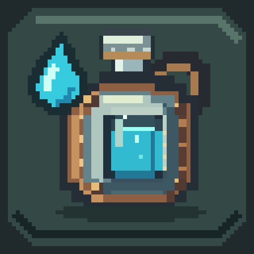

# Thirsty 口渴模组

Thirsty 给生存和冒险模式加了一条口渴值。你需要找水、装水、净水，再用水瓶或水容器喝水。

## 安装

本模组需要 LeviLamina 26.51.5，支持 Windows x64。

从 [发布页面](https://github.com/yangyangzhong82/thirsty/releases) 下载对应版本的压缩包，解压后安装：

- **单人游戏**：下载客户端版本，把里面的 `thirsty` 文件夹放进客户端的 `mods` 目录。
- **多人服务器**：下载服务端版本，把里面的 `thirsty` 文件夹放进服务器的 `plugins` 目录；玩家也要安装客户端版本。
- 客户端和服务器必须使用相同的游戏、LeviLamina 和模组版本。

`thirsty` 文件夹里已经包含 DLL、行为包和资源包，整个文件夹一起复制。模组会自动加载物品包，不需要手动导入 `.mcaddon` 或勾选世界附加包。更新文件后重启游戏或服务器。

只在客户端安装，连接没有安装本模组的服务器时，不会显示口渴条。

如果你使用 lip，也可以直接安装：

```powershell
# 服务端
lip install github.com/yangyangzhong82/thirsty

# 客户端
lip install github.com/yangyangzhong82/thirsty#client
```

## 口渴值怎么用

- 最大口渴值是 **20**，出生和重生时回满。
- 只在生存、冒险模式生效；创造和旁观模式不会消耗，也不会显示口渴条。
- 口渴条在饥饿条上方，一共有 10 个水滴，每个水滴代表 2 点；剩下 4 点及以下时变成橙色。
- 默认情况下，普通环境每 4 秒消耗 0.07 点；沙漠、丛林等炎热或潮湿的环境消耗 0.14 点，下界环境消耗 0.21 点。
- 疾跑、游泳、滑翔会额外消耗；跳跃、挖方块和攻击也会消耗少量口渴值。
- 低于 6 点时会获得挖掘疲劳 I。降到 0 点后，默认每 4 秒受到半颗心伤害。
- 吃东西也可能改变口渴值，例如西瓜片 +2、苹果 +1、蜂蜜瓶 +3、牛奶 +4；腐肉和干海带会减少 1 点。

口渴值会随存档保存，退出再进不会回满。游戏真正暂停时，口渴消耗也会暂停。

喝水时要把水喝完才会恢复口渴值。中途松手不会恢复，也不会触发水质效果。

## 水瓶和水容器

水有四种水质：脏水、有点脏的水、能接受的水、纯净水。容器名称会显示水质和剩余口数，图标中的水位也会变化。放进箱子、丢在地上或退出游戏都不会改变水质和剩余水量。

### 取水

- 空玻璃瓶对着水面使用，会得到脏水瓶。
- 空水袋、水壶或铜水壶对着水面使用，可以装满对应容量的水。
- 用水容器在高度超过 100 的地方取水，或者在高度低于 48 且不见天的地方取水，会得到“有点脏的水”；其他地方默认是脏水。玻璃瓶从水面装出的仍是脏水。
- 下雨时，站在露天能淋到雨的地方，用空玻璃瓶或空水容器接雨水，可以得到“有点脏的水”。
- 水桶可以在工作台上给空容器装满脏水，并返还空桶。
- 水炼药锅正下方放火、灵魂火、岩浆或点燃的营火，可以装出“能接受的水”；不加热时装出脏水。每次取水会消耗一层锅里的水。
- 也可以潜行、空手对着水面按使用键直接喝水（默认鼠标右键）；每次恢复 2 点，间隔 1 秒。水质也由取水位置决定，喝脏水容易反胃。

### 净水

把水瓶或装了水的容器放进熔炉、营火或灵魂营火，每次加热提升一级水质：

**脏水 → 有点脏的水 → 能接受的水 → 纯净水**

在合成栏中将水瓶或容器与一个木炭滤芯放在一起，也能提升一级水质，并消耗滤芯。容器里剩余的水会一起净化，口数不变。

木炭滤芯配方：从上到下放纸、木炭、沙子，一次做出 2 个。

原版的普通水瓶就是纯净水瓶，可以用于酿药。从外面装来的水需要先净化到纯净，才能用于酿药。

### 容器

| 容器 | 容量 | 合成材料 |
| --- | ---: | --- |
| 水袋 | 2 口 | 3 个皮革、1 根线 |
| 水壶 | 4 口 | 5 个铁锭 |
| 铜水壶 | 8 口 | 8 个铜锭、1 个空水壶 |

工作台配方如下：`L` 是皮革，`S` 是线，`I` 是铁锭，`C` 是铜锭，`F` 是空水壶，`.` 是空槽。

```text
水袋       水壶       铜水壶
. S .      I . I      C C C
L . L      I . I      C F C
. L .      . I .      C C C
```

每喝一口只消耗 1 口水，喝完后会留下空容器。空容器或没装满的容器可以用水瓶补水，每瓶补 1 口并返还玻璃瓶；已有水时只能补入相同水质的水。

默认恢复量和副作用如下：

| 水质 | 每口恢复 | 反胃概率 |
| --- | ---: | ---: |
| 脏水 | 3 | 60% |
| 有点脏的水 | 4 | 20% |
| 能接受的水 | 5 | 1% |
| 纯净水 | 6 | 0% |

反胃默认持续 20 秒，期间每 5 秒会额外消耗 1 点口渴值。如果你已经在反胃，再喝脏水还有 30% 的概率中毒 10 秒。纯净水不会触发这些负面效果。

## 配置

第一次启动后，配置会生成在模组目录的 `config/config.json`。修改后重启游戏或服务器。

每个选项上方都有一条 `_comment_` 开头的中文说明，改下面的数值或开关即可。`true` 表示开启，`false` 表示关闭。单人游戏修改客户端配置；多人游戏的玩法规则由服务器配置决定，口渴条位置由各自的客户端配置决定。

下面列出各个选项的含义。生物群系列表只展示一部分，平时直接修改生成的配置即可。

```jsonc
{
    "version": 7, // 配置版本号，不要修改
    "baseDrainPer4Seconds": 0.07, // 普通环境每 4 秒消耗
    "biomeBaseDrainPer4Seconds": { // 指定生物群系每 4 秒消耗；未列出的使用上面的值
        "minecraft:desert": 0.14,
        "minecraft:savanna": 0.14,
        "minecraft:jungle": 0.14,
        "minecraft:hell": 0.21,
        "minecraft:crimson_forest": 0.21,
        "minecraft:warped_forest": 0.21,
        "minecraft:soulsand_valley": 0.21,
        "minecraft:basalt_deltas": 0.21
    },
    "activityDrainPer4Seconds": 0.2, // 疾跑、游泳、滑翔时每 4 秒额外消耗
    "jumpDrain": 0.05, // 每次跳跃消耗
    "breakBlockDrain": 0.01, // 挖掉一个方块消耗
    "attackDrain": 0.02, // 成功攻击一次消耗
    "lowThirstThreshold": 6.0, // 低于此值时获得挖掘疲劳
    "lowThirstFatigueAmplifier": 0, // 挖掘疲劳等级，0 表示 I 级
    "waterBottleRestore": 6, // 纯净水每口恢复
    "dirtyWaterRestore": 3, // 脏水每口恢复
    "slightlyDirtyWaterRestore": 4, // 有点脏的水每口恢复
    "acceptableWaterRestore": 5, // 能接受的水每口恢复
    "dirtyWaterDebuffChance": 60, // 脏水反胃概率（百分比）
    "slightlyDirtyWaterDebuffChance": 20, // 有点脏的水反胃概率
    "acceptableWaterDebuffChance": 1, // 能接受的水反胃概率
    "dirtyWaterDebuffSeconds": 20, // 反胃持续秒数
    "nauseaSecondsPerPoint": 5, // 反胃时每隔多少秒额外扣 1 点，0 关闭
    "dirtyWaterPoisonChance": 30, // 已经反胃时喝脏水的中毒概率
    "dirtyWaterPoisonSeconds": 10, // 中毒持续秒数
    "poisonFromAnyImpureWater": false, // true：已经反胃时，喝任何非纯净水都可能中毒
    "handDrinkRestore": 2, // 空手对水面饮水每次恢复
    "handDrinkDebuffChance": 60, // 空手喝脏水反胃概率；其他水质使用对应概率
    "foodThirst": { // 食物 ID 对口渴值变化；负数表示减少口渴值
        "minecraft:melon_slice": 2,
        "minecraft:sweet_berries": 1,
        "minecraft:glow_berries": 1,
        "minecraft:apple": 1,
        "minecraft:honey_bottle": 3,
        "minecraft:milk_bucket": 4,
        "minecraft:mushroom_stew": 3,
        "minecraft:beetroot_soup": 3,
        "minecraft:rabbit_stew": 3,
        "minecraft:rotten_flesh": -1,
        "minecraft:dried_kelp": -1
    },
    "damageWhenEmpty": true, // 口渴为 0 时是否受伤
    "damageIntervalSeconds": 4, // 受伤间隔秒数
    "damageAmount": 1.0, // 每次伤害，1.0 是半颗心
    "hudOffsetX": 0.0, // 口渴条水平偏移
    "hudOffsetY": -20.0 // 口渴条垂直偏移，负数表示向上
}
```

`dirtyWaterDebuffChance`、`slightlyDirtyWaterDebuffChance` 和 `acceptableWaterDebuffChance` 的范围是 0 到 100。把概率设为 0 就关闭对应的反胃效果。数值超出合理范围时，模组会自动限制到可用范围。

想让口渴掉得慢一些，可以调低基础消耗、生物群系消耗和活动消耗；不想口渴到 0 后掉血，把 `damageWhenEmpty` 改成 `false`；不想出现挖掘疲劳，把 `lowThirstThreshold` 改成 `0`。
